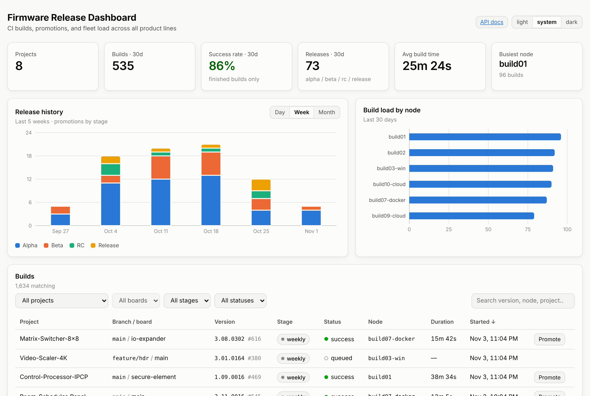

# Firmware Release Dashboard

This repo is strictly for learning purposes by me.

A full-stack **TypeScript** recreation of a firmware CI/CD portal: a REST API that records
builds from CI pipelines and promotes them through release stages, plus a React dashboard that
visualises release history, fleet load, and build status across product lines.

The original system is a Python/Flask + Jinja portal used daily by ~400 engineers. This project rebuilds
the core of it on a modern TypeScript stack to make the same ideas — gated promotion, aggregation-driven
analytics, documented APIs — explicit and testable.

[](https://github.com/ZeroSudoSpell/frDashboard/actions/workflows/ci.yml)

<picture>
  <source media="(prefers-color-scheme: dark)" srcset="docs/dashboard-dark.png">
  
</picture>

<sub>Running locally against the seed data (<code>npm run seed</code>). Light and dark themes follow your system setting.</sub>


## Stack

| Layer | Choice | Why |
|---|---|---|
| API | Node 22 · Express 4 · TypeScript (ESM, strict) | Small, explicit, easy to reason about |
| Validation + docs | Zod · `@asteasolutions/zod-to-openapi` · Swagger UI | One schema validates requests **and** generates the OpenAPI spec, so docs can't drift |
| Database | MongoDB 7 · Mongoose | Build metadata is document-shaped and read-heavy; analytics run as aggregation pipelines |
| Web | React 18 · Vite · TanStack Query · Recharts | Typed data fetching with caching/invalidation; charts built to a validated, colour-blind-safe palette |
| Tests | Jest + Supertest + `mongodb-memory-server` (API) · Vitest + Testing Library (web) | Integration tests run against a real in-memory Mongo replica set |
| Ops | Docker (multi-stage) · Docker Compose · Nginx · GitHub Actions | Same-origin deployment; CI runs lint → typecheck → test → build → image build |

## Architecture

```
┌──────────────┐   /api/*   ┌──────────────────────────────┐        ┌──────────────┐
│  web (nginx) │ ─────────▶ │  api (Express + TypeScript)  │ ─────▶ │  MongoDB 7   │
│  React SPA   │            │  routes → services → models  │        │  (replica    │
└──────────────┘            │  Zod validation · OpenAPI    │        │   set, txns) │
                            └──────────────────────────────┘        └──────────────┘
                                   ▲
                 CI pipelines ─────┘  POST /api/builds · PATCH /api/builds/:id/status
```

**Domain model**

- `Project` — a firmware product line: boards, branches, part number.
- `Build` — one CI run of project × branch × board. Indexed on `(project, startedAt)` for the
  dashboard's hottest query and unique on `(project, branch, board, jenkinsBuildNumber)`.
- `Release` — a promotion event. A version moves **forward only** through
  `nightly → weekly → alpha → beta → rc → release`.

**Promotion guardrails** (`POST /api/releases/promote`) mirror a real release pipeline:

1. only `success` builds can be promoted;
2. promotion must move to a later stage;
3. a version cannot be published to the same stage twice (duplicate-release check);
4. the `Release` insert and the `Build` stage advance run in a **transaction** when the
   server is a replica set, so the two can never disagree.

**Analytics** (`/api/analytics/*`) are MongoDB aggregation pipelines (`$dateTrunc`, `$group`,
conditional `$sum`) so the API returns exactly the slice a chart needs instead of paging
collections through Node.

## Running it

### With Docker (recommended)

```bash
docker compose up --build
# web:   http://localhost:8080
# api:   http://localhost:4000/api/docs   (Swagger UI)
```

Then seed some data (from the host, against the exposed Mongo port):

```bash
npm install
MONGO_URI="mongodb://localhost:27017/firmware_dashboard?replicaSet=rs0&directConnection=true" npm run seed
```

### Locally

```bash
npm install
cp api/.env.example api/.env        # point MONGO_URI at a Mongo 6+/7 instance
npm run seed                         # 8 projects, ~90 days of builds and promotions
npm run dev                          # api on :4000, web on :5173 (proxies /api)
```

### Tests

```bash
npm test                 # API integration tests (in-memory Mongo) + web unit tests
npm run lint && npm run typecheck
```

The API tests start a single-node in-memory replica set via `mongodb-memory-server` so that
transactions are exercised. On a machine that cannot download the MongoDB binary, point them at
an existing instance instead: `MONGO_TEST_URI=mongodb://localhost:27017/frd_test npm test -w api`.

## API overview

Full, generated reference at `/api/docs` (Swagger UI) or `/api/openapi.json`.

| Method | Path | Purpose |
|---|---|---|
| `GET` | `/api/health` | Liveness + DB connection state |
| `GET/POST` | `/api/projects` | List / create product lines |
| `GET` | `/api/builds` | Filter (`project`, `branch`, `board`, `stage`, `status`, `from`, `to`), free-text `search`, `sort`, pagination |
| `POST` | `/api/builds` | Record a build (called by CI when a job starts) |
| `PATCH` | `/api/builds/:id/status` | Finish a build; terminal states are immutable |
| `GET` | `/api/releases` | Promotion history |
| `POST` | `/api/releases/promote` | Promote a build with the guardrails above |
| `GET` | `/api/analytics/summary` | 30-day headline numbers |
| `GET` | `/api/analytics/release-histogram?range=day\|week\|month` | Releases per bucket, split by stage |
| `GET` | `/api/analytics/node-load` | Builds / failures / avg duration per CI node |

Errors share one shape — `{ "error": string, "details"?: unknown }` — with `400` for validation,
`404` not found, `409` for guardrail/duplicate conflicts, `422` for semantic errors (unknown board).

## Project layout

```
api/
  src/
    app.ts            Express app factory (testable without a port)
    server.ts         Startup, graceful shutdown
    config.ts         Env validated with Zod at boot
    domain.ts         Stage lifecycle rules shared by models, schemas, services
    models/           Mongoose schemas + indexes
    schemas/          Zod request/response schemas → OpenAPI registry
    routes/           Thin HTTP layer; registers paths with the OpenAPI registry
    services/         Business logic + aggregation pipelines
    middleware/       Validation and central error handling
    scripts/seed.ts   Deterministic sample data (SEED=42)
  tests/              Supertest integration tests + pure unit tests
web/
  src/
    lib/api.ts        Typed fetch client
    lib/types.ts      API contract types
    components/       SummaryTiles, ReleaseHistogram, NodeLoadChart, BuildsTable, PromoteDialog
deploy/nginx.conf     Static hosting + /api reverse proxy
docker-compose.yml    mongo (replica set) · api · web
.github/workflows/    CI
```

## Roadmap

- Terraform + Helm chart for a Kubernetes deployment (EKS / k3s)
- Auth (OIDC) and per-project RBAC on promotion
- Webhook from Jenkins so builds self-register
